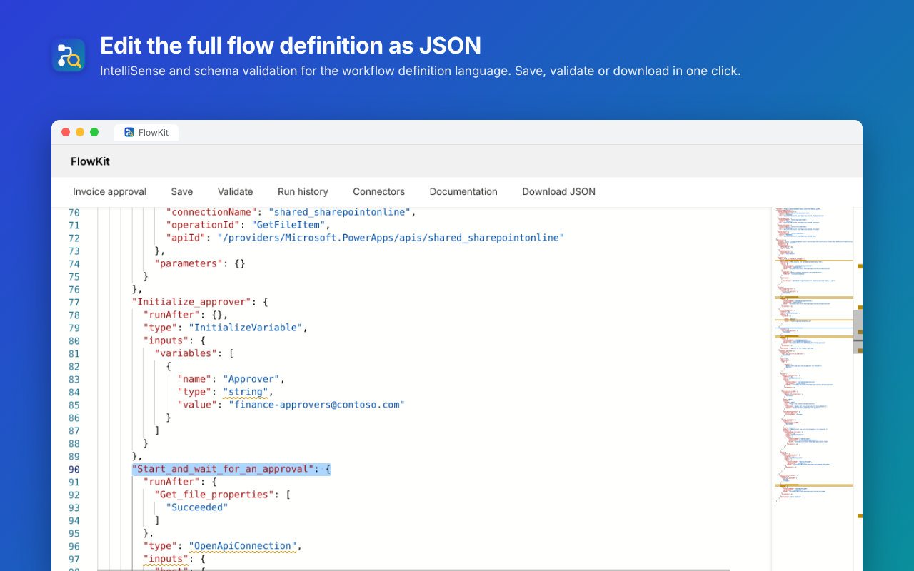
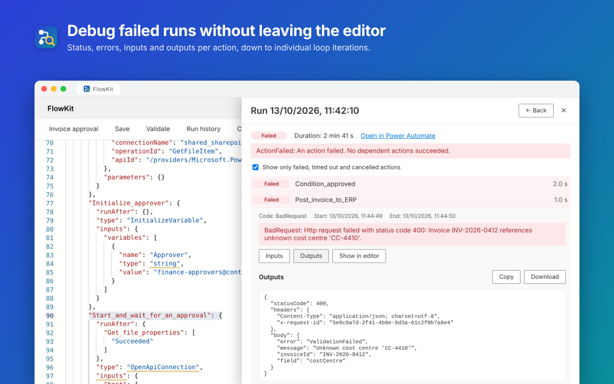
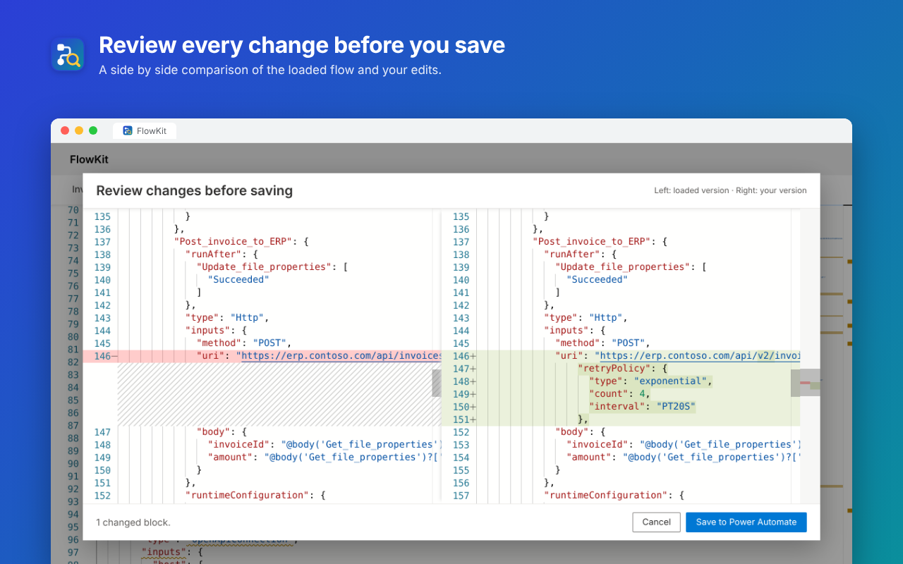
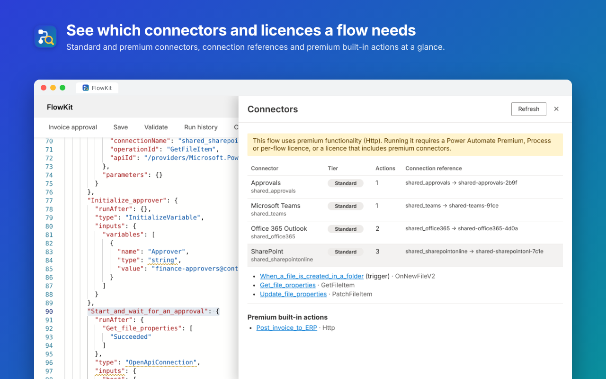
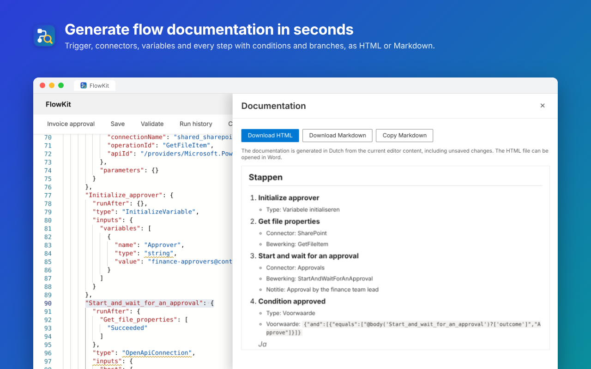

  

<h1 align="center">FlowKit for Power Automate</h1>

  Edit, debug and document your Power Automate cloud flows from a single browser extension.

FlowKit opens the flow you are viewing in Power Automate in a full JSON editor. From there you can browse the run history, review your changes before saving, see which connectors and licences the flow needs and generate documentation. The extension works in Chrome and Microsoft Edge.

## Features

### JSON editor
Edit the complete flow definition including connection references in an editor with IntelliSense and schema validation for the Power Automate workflow definition language. From the toolbar you can:

- **Save**: save the flow to Power Automate after reviewing your changes.
- **Validate**: run the Power Automate flow checker on your edited definition, with errors and warnings shown in a separate panel.
- **Download JSON**: save the definition as `<flow name>.json`, for example as a backup or to share it.

### Run history
Debug failed runs without leaving the editor. You see the most recent runs with their status and duration, and you can filter them on status. Open a run to get the status, error message and duration of every action, in the order in which the actions ran. When a run has failed, only the actions with problems are shown at first.

For every action you can view, copy or download the inputs and outputs. "Show in editor" takes you straight to that action in the JSON. For loops you see the individual iterations, with a filter for the iterations that did not succeed. A link opens the same run in Power Automate.

### Review changes before saving
Before FlowKit saves anything, you see a side by side comparison of the loaded version and your version. The flow is only updated once you click "Save to Power Automate", so an unintended change never ends up in production.

### Connectors and licences
An overview of every connector the flow uses, with its licence tier (Standard or Premium), the number of actions and the connection reference. Click a connector to see which actions use it and jump to them in the editor. Premium built-in actions such as the HTTP action and the "When a HTTP request is received" trigger are listed separately. At the top you see at a glance whether the flow needs a premium licence.

The licence tier is retrieved from Power Automate. If that is not possible, FlowKit falls back to a built-in list and marks the tier with an asterisk.

### Documentation export
Create readable documentation of a flow in seconds, for example when handing a flow over to a customer or colleague. The documentation contains:

- general details such as environment, status and licence requirements
- the trigger with its schedule and trigger conditions
- the connectors and variables used
- every step in execution order, including conditions, Yes/No branches, notes and non-default "run after" settings

Download the result as HTML (opens in Word) or Markdown. The documentation is currently generated in Dutch.

## Usage
1. Open a flow in [Power Automate](https://make.powerautomate.com), for example its details page or the designer.
2. Click the FlowKit icon in your browser toolbar. The icon is only active on a page that shows a flow.
3. The flow opens in a new tab with the editor and all tools.

If you see a message asking you to refresh the page, refresh the tab with the flow in Power Automate and click the icon again.

## Installation
Until FlowKit is available in the browser stores, install it as follows:

1. Download or clone this repository.
2. Go to `chrome://extensions` in Chrome or `edge://extensions` in Edge.
3. Turn on developer mode.
4. Choose "Load unpacked" and select the `extension` folder.

## Privacy
FlowKit has no servers of its own and does not collect any data. The extension uses your existing Power Automate session to call Microsoft's APIs on your behalf. Tokens are kept in browser memory only and are never sent anywhere other than Microsoft. Read the full [privacy policy](PRIVACY.md).

## Project structure

| Folder or file | Contents |
| --- | --- |
| `extension/` | The extension itself, ready to load or to zip for the stores |
| `extension/background.js` | Detects flow pages and manages the session |
| `extension/features.js` | Run history, change review, connectors and documentation |
| `design/` | Icon source files (`icon.svg`, plus `icon-small.svg` for 16 and 32px) and large versions for the stores |
| `design/store-screenshots/` | Screenshots for the stores and this README |

## Acknowledgements
FlowKit is based on the Power Automate Tools extension and extends it with new features and fixes.

FlowKit is not affiliated with or endorsed by Microsoft. Power Automate is a trademark of the Microsoft group of companies.
